# Лабораторная работа №6

**Тема:** Система контроля версий

**Выполнил:** Фарсиев Р.И.  
**Группа:** 4516

## Цель работы

Изучение базовых возможностей системы управления версиями, получение опыта работы с Git API, локальным и удалённым репозиториями.

## Ход выполнения работы

### 1. Создание аккаунта GitHub

Для выполнения лабораторной работы использовался аккаунт на платформе GitHub, предназначенной для хранения удалённых Git-репозиториев и совместной работы над проектами.

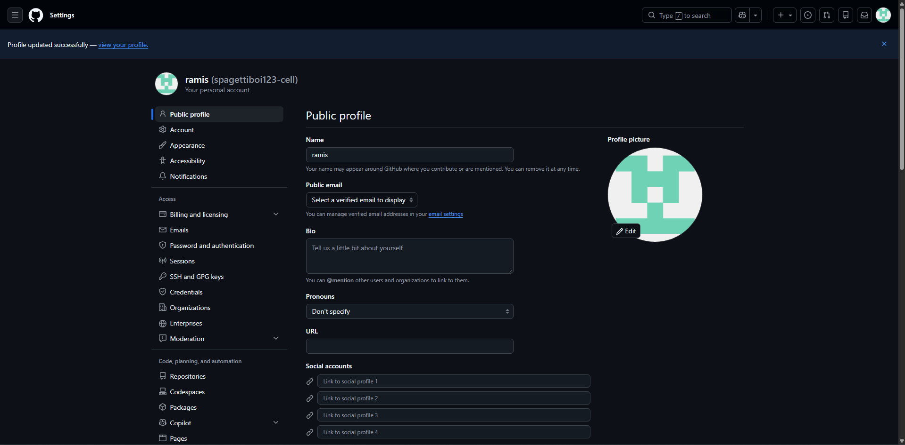

### 2. Создание копии репозитория (Fork)

С помощью функции Fork была создана личная копия исходного репозитория Kurtyanik/LR6. Копия размещена в собственном аккаунте GitHub, что позволяет независимо вносить изменения и сохранять историю работы.

**Ссылка на репозиторий:** https://github.com/spagettiboi123-cell/LR6

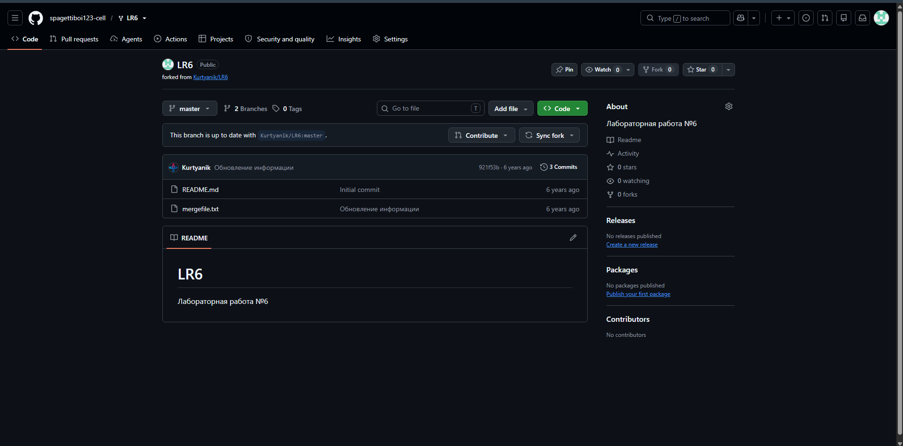

### 3. Установка Git

Для работы с системой контроля версий был установлен Git для Windows. После установки стал доступен терминал Git Bash, через который выполнялись основные команды лабораторной работы.

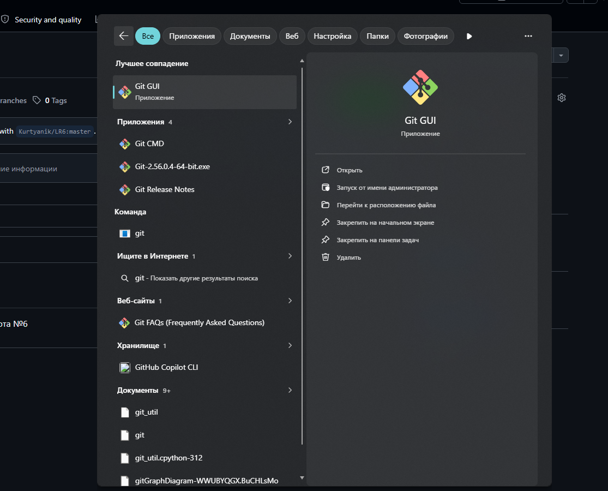

### 4. Настройка Git

Выполнена первоначальная настройка Git. С помощью команды `git config` указаны имя пользователя и адрес электронной почты. Корректность параметров проверена выводом глобальной конфигурации.

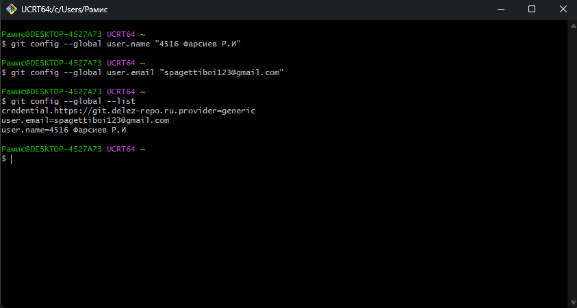

### 5. Клонирование репозитория

Личный удалённый репозиторий был клонирован на компьютер с помощью команды `git clone`. После клонирования проверены адрес удалённого репозитория и существующие ветки.

Локальная копия расположена в каталоге `GitLabs/LR6`.

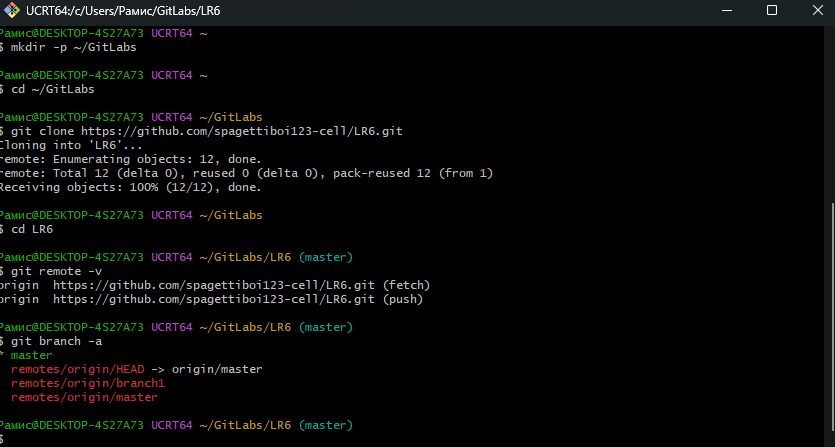

### 6. Синхронизация изменений

Через веб-интерфейс GitHub в ветку `master` добавлен файл `test.txt`. После этого командой `git pull origin master` изменения были загружены в локальный репозиторий.

Успешная синхронизация подтверждена наличием нового файла и соответствующего коммита в истории.

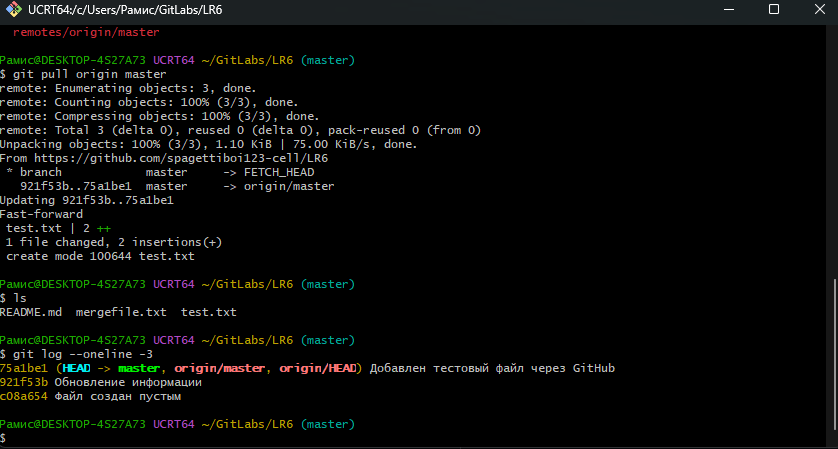

### 7. Просмотр истории операций

Получена история коммитов основной ветки `master` и побочной ветки `branch1`.

Для наглядного представления структуры репозитория использована команда `git log` с параметрами `--all`, `--oneline`, `--graph` и `--decorate`.

В результате получен граф, отображающий последовательность коммитов и разделение веток.

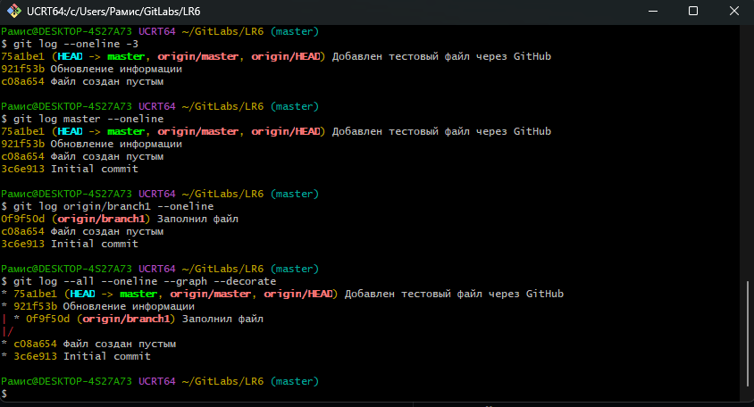

### 8. Просмотр последних изменений

С помощью команды `git show` изучены последние изменения в коммитах основной и побочной веток.

Команда `git diff` позволила сравнить содержимое веток и определить различия между версиями файлов.

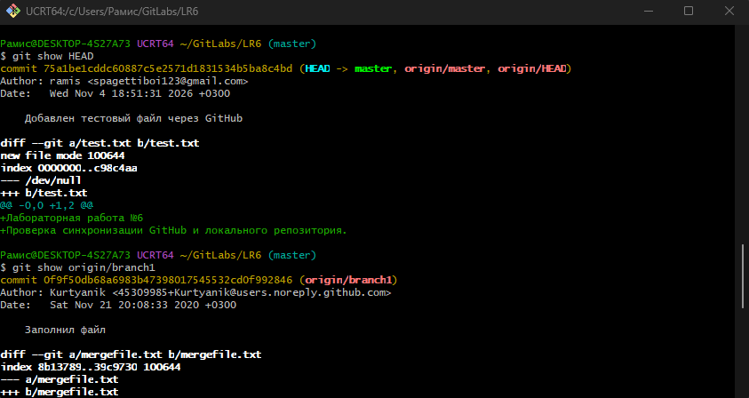

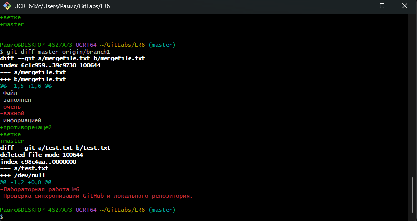

### 9. Слияние веток и разрешение конфликта

Выполнено слияние побочной ветки `branch1` с основной веткой `master` с помощью команды `git merge`.

В процессе слияния возник конфликт содержимого файла `mergefile.txt`, поскольку обе ветки содержали несовместимые изменения.

Конфликт был разрешён вручную: файл открыт в текстовом редакторе, удалены служебные маркеры конфликта и сохранено необходимое содержимое обеих веток.

После исправления файл добавлен в индекс Git, а слияние завершено отдельным коммитом.

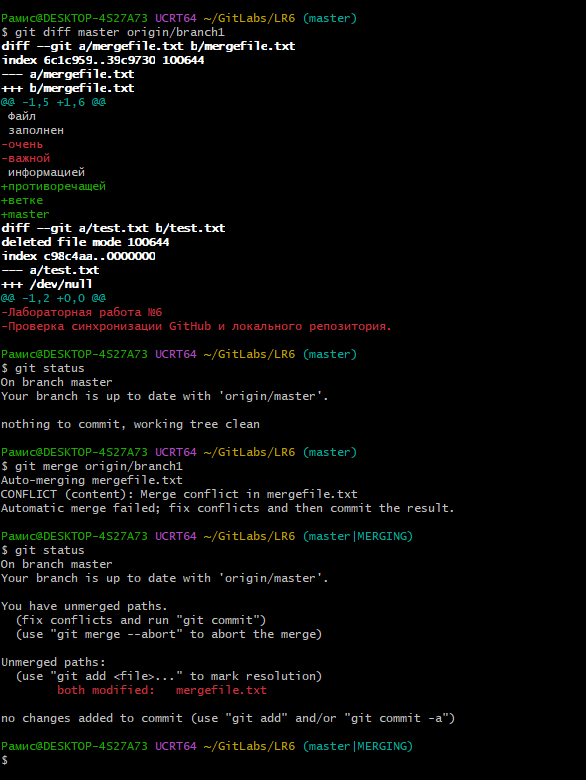

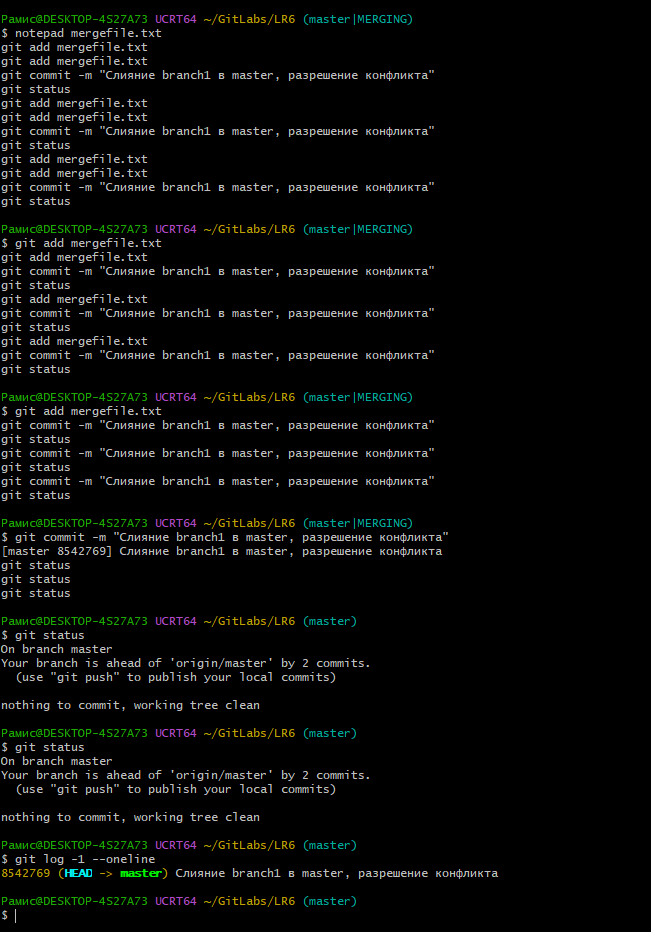

### 10. Удаление побочной ветки

После успешного слияния удалена удалённая ветка `branch1` с помощью команды `git push origin --delete branch1`.

Проверка списка веток показала, что побочная ветка удалена. При этом история её коммитов осталась доступной в истории основной ветки.

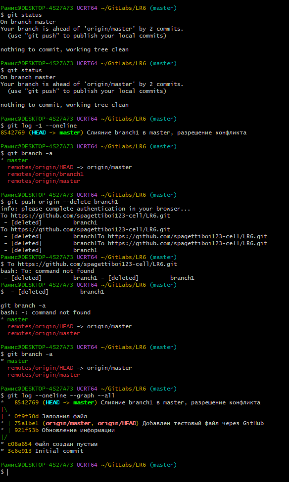

### 11. Создание нескольких коммитов

Для изучения фиксации изменений в файл `test.txt` последовательно добавлены три новые строки.

Каждое изменение отдельно добавлялось в индекс Git и фиксировалось командой `git commit` с соответствующим комментарием.

В результате в истории появились три последовательных коммита, отражающих этапы изменения файла.

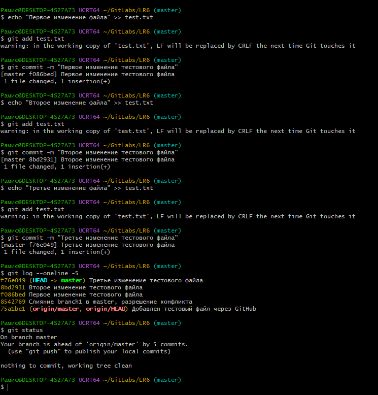

### 12. Откат коммита

Для отмены последнего изменения использована команда `git revert --no-edit HEAD`.

В результате был создан новый коммит, отменяющий третье изменение файла `test.txt`. При этом исходный коммит сохранился в истории репозитория.

Проверка содержимого файла подтвердила успешный откат.

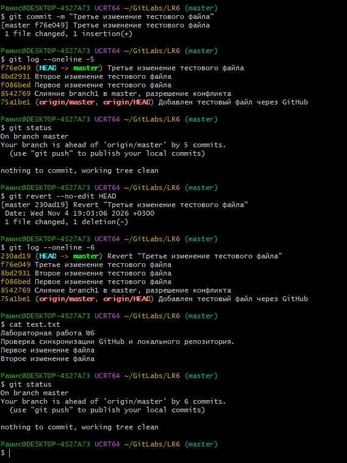

### 13. Создание ветки для отчёта

Для оформления отчёта создана отдельная ветка `report` с помощью команды `git switch -c report`.

Переключение на новую ветку проверено командами `git branch` и `git status`.

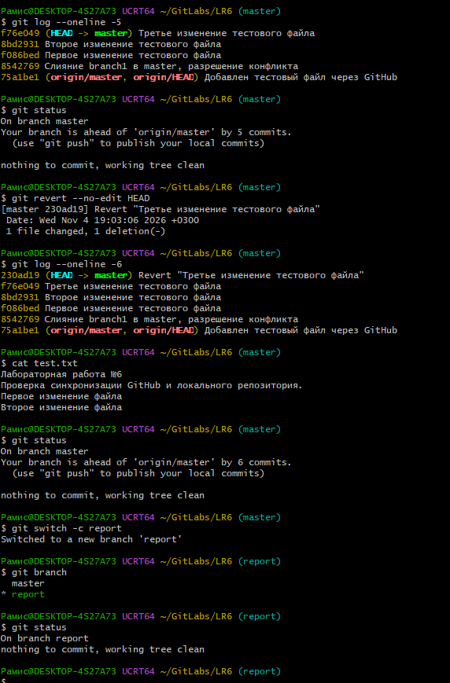

### 14. Оформление отчёта

Отчёт оформлен в файле `README.md` с использованием языка разметки Markdown.

Для представления результатов использованы заголовки, текстовые описания, фрагменты команд и изображения.

Все 15 снимков экрана размещены в отдельной папке `screenshots`. В процессе оформления отчёта периодически выполнялась фиксация изменений с комментариями.

### 15. Получение форматированной истории операций

С помощью команды `git log` получена история коммитов в форматированном виде.

Для каждого коммита отображаются сокращённый хеш, дата создания, имя автора и комментарий.

Полученная история приведена в разделе «История операций».

### 16. Отправка изменений на GitHub

После завершения локальной работы выполнена отправка изменений в удалённый репозиторий GitHub.

Сначала командой `git push origin master` опубликованы изменения основной ветки.

Затем командой `git push -u origin report` опубликована ветка с отчётом и скриншотами.

Проверка состояния репозитория подтвердила успешную синхронизацию локальной ветки `report` с `origin/report`.

**Ссылка на отчёт:** https://github.com/spagettiboi123-cell/LR6/tree/report

---

## Лог выполненных команд

Ниже приведены команды, использованные при выполнении лабораторной работы, без результатов их выполнения.

### Настройка и клонирование

```bash
git config --global user.name "4516 фарсиев Р.И"
git config --global user.email "spagettiboi123@gmail.com"
git config --global --list

mkdir -p ~/GitLabs
cd ~/GitLabs
git clone https://github.com/spagettiboi123-cell/LR6.git
cd LR6
git remote -v
git branch -a
```

### Синхронизация и просмотр истории

```bash
git pull origin master
ls
git log --oneline -3

git log master --oneline
git log origin/branch1 --oneline
git log --all --oneline --graph --decorate

git show HEAD
git show origin/branch1
git diff master origin/branch1
```

### Слияние веток

```bash
git status
git merge origin/branch1
git status

notepad mergefile.txt
git add mergefile.txt
git commit -m "Слияние branch1 в master, разрешение конфликта"

git status
git log --all --oneline --graph --decorate
```

### Удаление побочной ветки

```bash
git branch -a
git push origin --delete branch1
git branch -a
git log --oneline --graph --all
```

### Создание коммитов

```bash
echo "Первое изменение файла" >> test.txt
git add test.txt
git commit -m "Первое изменение тестового файла"

echo "Второе изменение файла" >> test.txt
git add test.txt
git commit -m "Второе изменение тестового файла"

echo "Третье изменение файла" >> test.txt
git add test.txt
git commit -m "Третье изменение тестового файла"

git log --oneline -5
git status
```

### Откат коммита

```bash
git revert --no-edit HEAD
git log --oneline -6
cat test.txt
git status
```

### Создание ветки отчёта

```bash
git switch -c report
git branch
git status
```

### Оформление отчёта

```bash
mkdir screenshots
explorer.exe screenshots
notepad README.md

git add README.md screenshots/
git commit -m "Начало оформления отчёта по лабораторной работе"

git add README.md screenshots/
git commit -m "Добавлены скриншоты выполнения лабораторной работы"

git add README.md
git commit -m "Дополнен лог команд и исправлено оформление отчета"

git ls-files screenshots/
git add screenshots/
git commit -m "Добавлены скриншоты первых этапов лабораторной"

git status
```

### Форматированная история операций

```bash
git log --all --pretty=format:"%h | %ad | %an | %s" --date=short
```

### Финальная фиксация и отправка изменений

```bash
git add README.md
git commit -m "Завершено оформление отчета и добавлена история коммитов"

git push origin master
git push -u origin report

git status
git branch -a
git push
```

---

## История операций

История коммитов получена с помощью команды `git log` и представлена в формате: сокращённый хеш, дата, имя автора и комментарий.

| Хеш | Дата | Автор | Комментарий |
|---|---|---|---|
| f7cd3f3 | 2026-11-04 | 4516 фарсиев Р.И | Завершено оформление отчета и добавлена история коммитов |
| 79e4430 | 2026-11-04 | 4516 фарсиев Р.И | Добавлены скриншоты первых этапов лабораторной |
| 185f359 | 2026-11-04 | 4516 фарсиев Р.И | Дополнен лог команд и исправлено оформление отчета |
| 2101cce | 2026-11-04 | 4516 фарсиев Р.И | Добавлены скриншоты выполнения лабораторной работы |
| e0ea1c6 | 2026-11-04 | 4516 фарсиев Р.И | Начало оформления отчёта по лабораторной работе |
| 230ad19 | 2026-11-04 | 4516 фарсиев Р.И | Revert "Третье изменение тестового файла" |
| f76e049 | 2026-11-04 | 4516 фарсиев Р.И | Третье изменение тестового файла |
| 8bd2931 | 2026-11-04 | 4516 фарсиев Р.И | Второе изменение тестового файла |
| f086bed | 2026-11-04 | 4516 фарсиев Р.И | Первое изменение тестового файла |
| 8542769 | 2026-11-04 | 4516 фарсиев Р.И | Слияние branch1 в master, разрешение конфликта |
| 75a1be1 | 2026-11-04 | ramis | Добавлен тестовый файл через GitHub |
| 921f53b | 2020-11-21 | Kurtyanik | Обновление информации |
| 0f9f50d | 2020-11-21 | Kurtyanik | Заполнил файл |
| c08a654 | 2020-11-21 | Kurtyanik | файл создан пустым |
| 3c6e913 | 2020-11-21 | Kurtyanik | Initial commit |

Полученная история подтверждает последовательное выполнение операций создания и изменения файлов, слияния веток, разрешения конфликта, отката коммита и оформления отчёта.

---

## Вывод

В ходе выполнения лабораторной работы были изучены основные возможности распределённой системы контроля версий Git и платформы GitHub.

На практике освоены создание копии удалённого репозитория, клонирование, синхронизация локальных и удалённых изменений, просмотр истории коммитов, создание и удаление веток, слияние с разрешением конфликта, фиксация изменений и откат коммита.

Получены практические навыки работы с терминалом Git Bash и оформления документации проекта с использованием Markdown. Выполненные операции позволили изучить основные принципы управления версиями и организации совместной работы с репозиториями.
